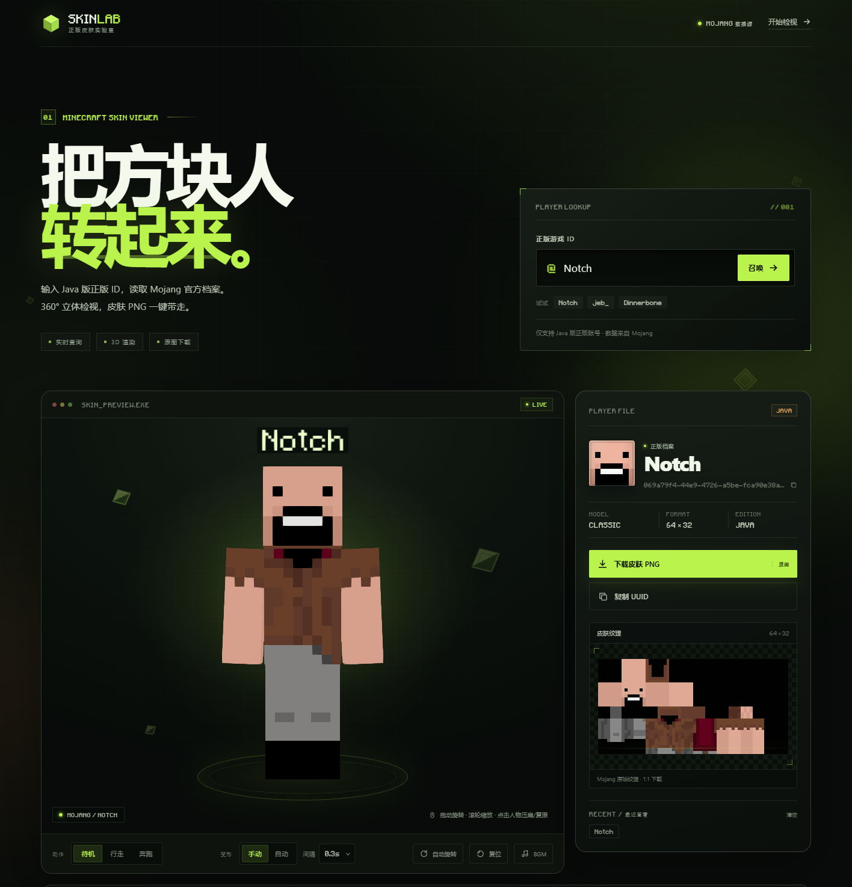

# SKINLAB — Minecraft 正版皮肤实验室

作者：Aoshkk2

输入 Minecraft Java 版正版 ID，读取 Mojang 官方档案，360° 查看立体皮肤，并下载原始 PNG 皮肤文件。



自动模式下的压扁效果：


## 功能

- **正版 ID 查询**：通过 Mojang API 校验并解析玩家档案，显示 UUID。
- **3D 皮肤预览**：基于 Three.js / skinview3d，支持拖动旋转、滚轮缩放、自动旋转。
- **点击变形（切换）**：第一次点击人物，宽度增加 1/3、高度缩小 1/3；再次点击恢复原始比例，可反复切换。点「复位」也会恢复视角与体型。缩放带平滑过渡动画。
- **自动循环变形**：工具栏的「手动 / 自动」开关可切换模式。自动模式下按所选的 **0.1–0.5 秒** 间隔切换「压扁 / 复原」，手动模式下由点击人物控制。
- **BGM 开关**：工具栏的「BGM」按钮可循环播放《朋友的酒（DJ版）》。音频已导入到 `public/audio/friends-wine-dj.mp3`。
- **模型自动识别**：自动区分 Classic（粗手臂）与 Slim（细手臂）皮肤。
- **披风支持**：玩家装备了 Mojang 披风时自动加载，并可单独下载披风纹理。
- **动作预览**：待机、行走、奔跑三种动画。
- **纹理与下载**：展示原始皮肤纹理，一键下载 1:1 原始 PNG（不压缩、不转码）。
- **历史记录**：最近查看的玩家保存在浏览器本地。
- **响应式布局**：桌面端与移动端均可使用。

## BGM 音频

BGM 文件已导入到：

```text
public/audio/friends-wine-dj.mp3
```

刷新页面后点击工具栏的「BGM」开关即可循环播放。音频由服务端直接读取，支持 HTTP Range 请求。

音乐版权归原作者及权利方所有，本项目仅作本地演示使用，请勿再分发该音频文件。

## 免费公网部署

推荐使用 Vercel Hobby 免费方案（通常不需要绑卡）：

见 [VERCEL.md](VERCEL.md)。

也可以使用 Render，项目附带 `render.yaml` 和 [DEPLOY.md](DEPLOY.md)；Render 可能要求银行卡做身份验证。免费实例会休眠，首次访问可能需要几十秒冷启动。

## 本地运行

环境要求：Node.js 20+，推荐使用 pnpm。

```bash
pnpm install
pnpm build
pnpm start
```

打开 <http://127.0.0.1:4173>。

Windows 下也可以直接双击项目根目录的 `start-website.bat`，它会启动服务并打开浏览器。网站依赖本地 Node 服务，服务停止后页面就无法打开；重新运行 `pnpm start` 或双击该脚本即可恢复。

开发模式（Vite HMR 与 API 共用同一个 Node 服务）：

```bash
pnpm dev
```

可用环境变量：

| 变量 | 默认值 | 说明 |
| --- | --- | --- |
| `PORT` | `4173` | 服务端口 |
| `HOST` | `127.0.0.1` | 监听地址；局域网访问可设为 `0.0.0.0` |

示例：

```bash
PORT=8080 HOST=0.0.0.0 pnpm start
```

## 实现说明

- 前端：原生 JavaScript + Vite + Three.js + skinview3d。
- 后端：Node.js 原生 HTTP 服务；同时负责静态文件、Mojang API 查询和纹理代理。
- 纹理经同源 `/api/skin/:name`、`/api/cape/:name` 代理，避免浏览器跨域限制，并提供 15 分钟内存缓存。
- Mojang 会话服务器不可用时，皮肤纹理自动回退到 mc-heads.net；玩家档案仍以 Mojang 查询结果为准。
- 页面首次打开会加载 `Notch` 作为示例；使用搜索后地址栏会带上 `?u=玩家ID`，可直接分享。

### 接口

| 方法 | 路径 | 说明 |
| --- | --- | --- |
| `GET` | `/api/health` | 健康检查 |
| `GET` | `/api/profile?username=Notch` | 查询玩家档案 |
| `GET` | `/api/skin/:username` | 获取皮肤 PNG 流 |
| `GET` | `/api/skin/:username?download=1` | 以附件下载皮肤 PNG |
| `GET` | `/api/cape/:username` | 获取披风 PNG 流 |

### 目录

```text
.
├── index.html          # 页面结构
├── src/
│   ├── main.js         # 查询、3D 渲染与交互
│   └── style.css       # 视觉样式与响应式布局
├── server.js           # API + 静态文件 + 纹理代理
├── public/             # 字体与 favicon
└── dist/               # 构建产物（pnpm build 生成）
```

## 数据与声明

皮肤、UUID、披风数据来自 Mojang 官方接口与 `textures.minecraft.net`。本项目为非官方工具，与 Mojang / Microsoft 无关联；皮肤纹理版权归原玩家所有。

界面使用的 Minecraft 像素字体来自 [skinview3d](https://github.com/bs-community/skinview3d) 随包资源（South-Paw/typeface-minecraft）。
